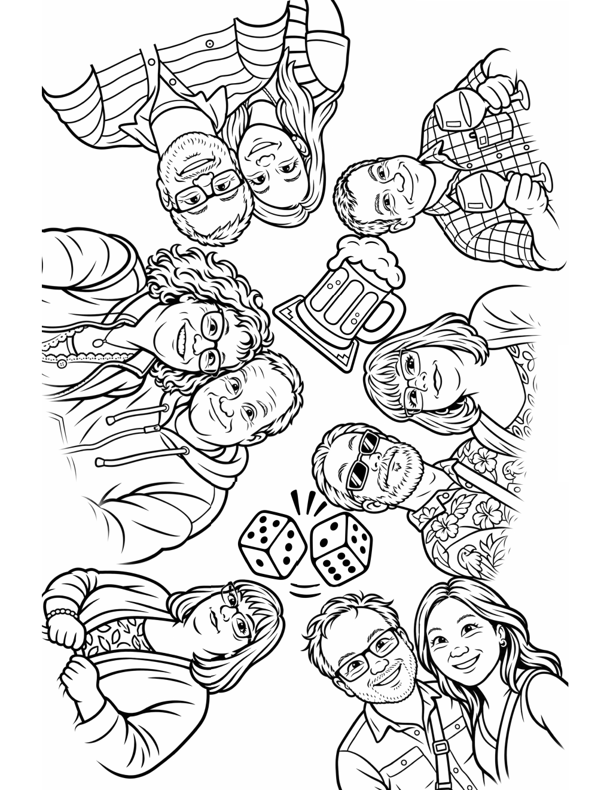

Had fun with this little project: I wanted to make a custom coloring pattern for a social event.  
I started by giving ChatGPT some pictures as references. We then explored some cartoon styles (ask to generate a few samples with different styles, provide feedback, and iterate until there's a result you like).  
Then I asked the agent to compose a page, but it was really boring (just a grid). So I asked to generate an interactive HTML page where I could do the layout (positioning, scaling, ...) with drag&drop.  
A small tweak was to ask for each component image to have a transparent background, so they could be laid out closer to each other.  
Finally, with the layout done, the result can be printed to PDF and printed.  

[Custom Coloring Page skill](https://github.com/jcouv/dotfiles/tree/main/codex/skills/custom-coloring-pages)

